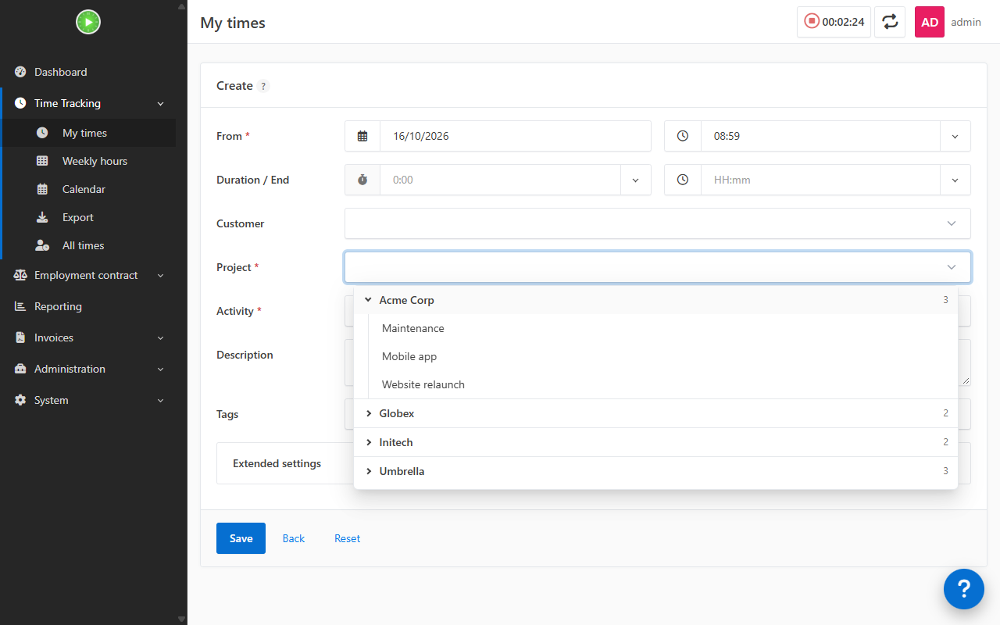

# CustomerGroupsBundle

A [Kimai](https://www.kimai.org) plugin for people with many customers and projects. In every project list
(the "Project" field of the timesheet and timer forms, the project filters...) the customer headers become a
collapsible tree:

- every customer starts closed when the list opens, showing its name, a chevron and the number of its projects;
- a click on a customer opens or closes its projects;
- while you type, the customers with matching projects open by themselves;
- the keyboard (arrows, Enter) skips the projects of closed customers;
- a list with the projects of one customer only (for example when the form already has a customer selected) shows
  them without the customer header.

Every select list (projects, activities, customers, users, tags...) also grows down to the bottom of the window,
instead of Kimai's fixed height of about six rows.



## Default project and activity

In the timesheet forms (start a timer, create or edit an entry), choosing a customer also selects a project:

- the only project of that customer (Kimai already does this by itself);
- otherwise the project of your latest entry for that customer, if that project is still in the list.

Then Kimai loads the activities of that project as usual. A project you pick yourself while the list is loading is
kept, and a customer without entries leaves the project empty.

The other way round, choosing a project fills in its customer, which Kimai leaves empty. The project list is not
reloaded: it still shows the projects of every customer, so you can switch to a project of another customer, and the
customer follows.

Choosing a project also selects an activity when Kimai selects none (Kimai does only when the project has a single
activity, and keeps the previous one if it is still in the list): the activity of your latest entry for that project,
if it is in the list. An activity you pick yourself is kept; one picked by the plugin follows the project: it becomes
the activity of your latest entry for the new project, or none if you have no entry there.

Until a project is chosen, the activity list is empty and disabled. Kimai lists the global activities there, but it
cannot save an entry without a project.

## Required customer

In the timesheet forms of the web pages the customer is required, like the project: its label has the asterisk, its
list has no empty choice, and a form sent without customer gets the error "This value should not be blank.". Kimai
treats the customer as an optional filter of the project list: the field is not saved, an entry takes the customer of
its project. Since choosing a project fills in its customer, nothing changes when you start from the project. The API
(used by the apps) is not changed.

## Touch screens

On a phone or tablet, tapping a select list in Kimai puts the cursor in its search box, so the on-screen keyboard
opens and covers half of the list. With the plugin, a tap with the finger opens the list without the keyboard: scroll
and tap a choice. To search by typing, tap the select again while its list is open, and the keyboard comes up. The
next time the list opens, it is again without the keyboard. Mouse and pen work as before.

On phones the popups with the forms (start a timer, edit an entry...) take the whole width of the screen: Kimai keeps
a margin around them, and on Android also a 1rem strip on the right for the popup's scrollbar. On touch screens the
popup has no scrollbar; it scrolls with the finger as before.

## Requirements

Kimai 2. Tested with 2.69.0.

## Installation

The plugin directory must be called `CustomerGroupsBundle`:

```sh
cd /path/to/kimai/var/plugins
git clone https://github.com/6801318d8d/CustomerGroupsBundle.git
cd /path/to/kimai
bin/console kimai:reload --env=prod
```

With the official Docker image (replace `kimai` with the name of your container):

```sh
git clone https://github.com/6801318d8d/CustomerGroupsBundle.git
docker cp CustomerGroupsBundle kimai:/opt/kimai/var/plugins/
docker exec kimai chown -R www-data:www-data /opt/kimai/var/plugins/CustomerGroupsBundle
docker exec -u www-data kimai /opt/kimai/bin/console kimai:reload --env=prod
```

Run `kimai:reload` as `www-data`: run as root, it leaves cache files that the web server cannot write.
Mount `/opt/kimai/var/plugins` on a volume, otherwise the plugin is lost when the container is recreated.

There is nothing to configure. To remove it, delete the `CustomerGroupsBundle` directory and run `kimai:reload`
again.

## How it works

Kimai renders its select lists with TomSelect and groups the projects by customer. Through
`ThemeEvent::STYLESHEET` and `ThemeEvent::JAVASCRIPT` the plugin adds a little CSS and JavaScript to every page of
a logged-in user. The script marks the dropdowns of project fields (ids ending in `_project`, or `projects`),
turns their group headers into toggles and hides the options of closed groups. TomSelect rebuilds the groups on
every render (opening, typing), so a `MutationObserver` applies the open/closed state again after each one.
On a touch tap (`pointerType` "touch") on a closed list, the search box gets `inputmode="none"`, which keeps the
on-screen keyboard down; a touch tap on the open list sets `inputmode="text"` and gives the box the focus again, which
brings the keyboard up. For the default project, the script waits until Kimai has loaded the projects of the chosen
customer (event `data-reloaded` of the project select) and, if none is selected, reads your latest entry for that
customer through Kimai's API (`GET /api/timesheets?customers[]=<id>&size=1`, with the session of the page). For the
customer of a project, it reads the `data-customer` attribute of the project option (or, for the options Kimai loads
from its API, the customer group the option is in) and sets the customer select without a `change` event, so that
Kimai does not reload the projects. For the default activity, it waits until Kimai has loaded the activities of the
project (event `data-reloaded` of the activity select) and reads your latest entry for that project
(`GET /api/timesheets?projects[]=<id>&size=1`); with no project it clears and disables the activity select. The
required customer is a form type extension of Kimai's timesheet forms (`TimesheetEditForm`, `TimesheetAdminEditForm`,
`TimesheetMultiUserEditForm`): it marks the customer field as required in the page and adds an error when the form
arrives without customer. Nothing is stored and no Kimai file is changed.

It relies on Kimai's frontend markup, which is not a public API: a future Kimai version may break it. In that case
the lists fall back to Kimai's own behaviour; please open an issue.

## Changes

- 1.5.0: in the timesheet forms, choosing a project selects the activity of your latest entry for that project; the
  activity list stays disabled until a project is chosen; the customer is required.
- 1.4.0: in the timesheet forms, choosing a project fills in its customer.
- 1.3.0: in the timesheet forms, choosing a customer selects the project of your latest entry for that customer.
- 1.2.0: on phones the popups with the forms take the whole width of the screen, without a scrollbar strip.
- 1.1.0: on touch screens the lists open without the on-screen keyboard; a second tap on the open list brings it
  up to search.
- 1.0.1: no customer header when the list holds the projects of one customer only.
- 1.0.0: first public version.

## License

MIT
