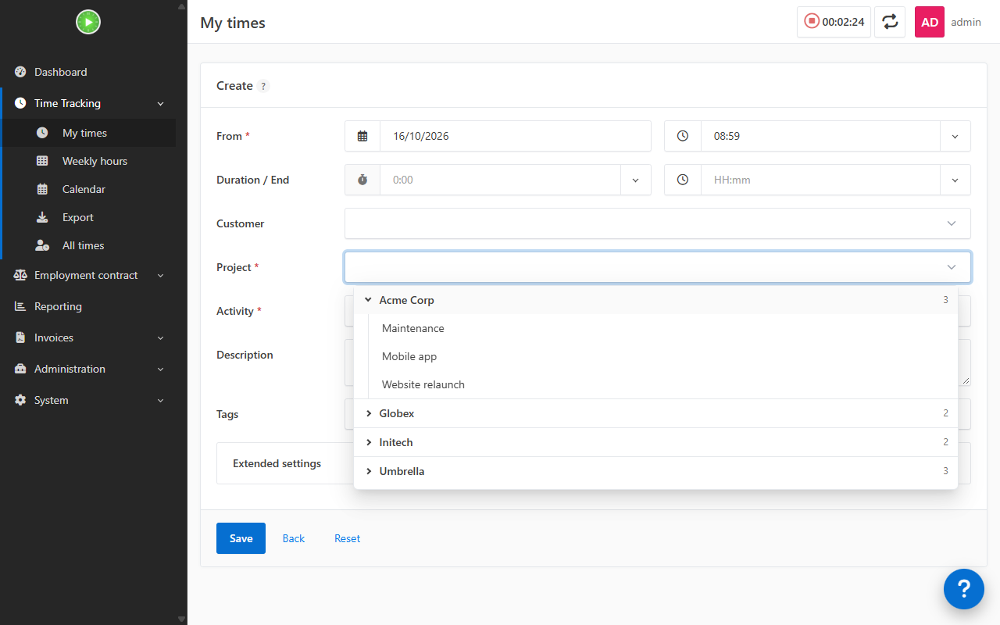

# CustomerGroupsBundle

A [Kimai](https://www.kimai.org) plugin for people with many customers and projects. In every project list
(the "Project" field of the timesheet and timer forms, the project filters...) the customer headers become a
collapsible tree:

- every customer starts closed when the list opens, showing its name, a chevron and the number of its projects;
- a click on a customer opens or closes its projects;
- while you type, the customers with matching projects open by themselves;
- the keyboard (arrows, Enter) skips the projects of closed customers;
- a list with the projects of one customer only (for example when the form already has a customer selected) shows
  them without the customer header.

Every select list (projects, activities, customers, users, tags...) also grows down to the bottom of the window,
instead of Kimai's fixed height of about six rows.



## Requirements

Kimai 2. Tested with 2.69.0.

## Installation

The plugin directory must be called `CustomerGroupsBundle`:

```sh
cd /path/to/kimai/var/plugins
git clone https://github.com/6801318d8d/CustomerGroupsBundle.git
cd /path/to/kimai
bin/console kimai:reload --env=prod
```

With the official Docker image (replace `kimai` with the name of your container):

```sh
git clone https://github.com/6801318d8d/CustomerGroupsBundle.git
docker cp CustomerGroupsBundle kimai:/opt/kimai/var/plugins/
docker exec kimai chown -R www-data:www-data /opt/kimai/var/plugins/CustomerGroupsBundle
docker exec -u www-data kimai /opt/kimai/bin/console kimai:reload --env=prod
```

Run `kimai:reload` as `www-data`: run as root, it leaves cache files that the web server cannot write.
Mount `/opt/kimai/var/plugins` on a volume, otherwise the plugin is lost when the container is recreated.

There is nothing to configure. To remove it, delete the `CustomerGroupsBundle` directory and run `kimai:reload`
again.

## How it works

Kimai renders its select lists with TomSelect and groups the projects by customer. Through
`ThemeEvent::STYLESHEET` and `ThemeEvent::JAVASCRIPT` the plugin adds a little CSS and JavaScript to every page of
a logged-in user. The script marks the dropdowns of project fields (ids ending in `_project`, or `projects`),
turns their group headers into toggles and hides the options of closed groups. TomSelect rebuilds the groups on
every render (opening, typing), so a `MutationObserver` applies the open/closed state again after each one.
Nothing is stored and no Kimai file is changed.

It relies on Kimai's frontend markup, which is not a public API: a future Kimai version may break it. In that case
the lists fall back to Kimai's own behaviour; please open an issue.

## Changes

- 1.0.1: no customer header when the list holds the projects of one customer only.
- 1.0.0: first public version.

## License

MIT
